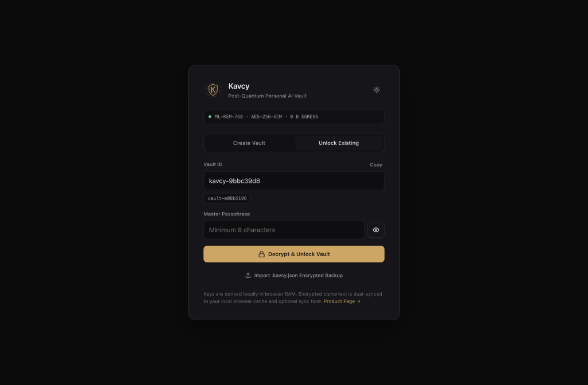
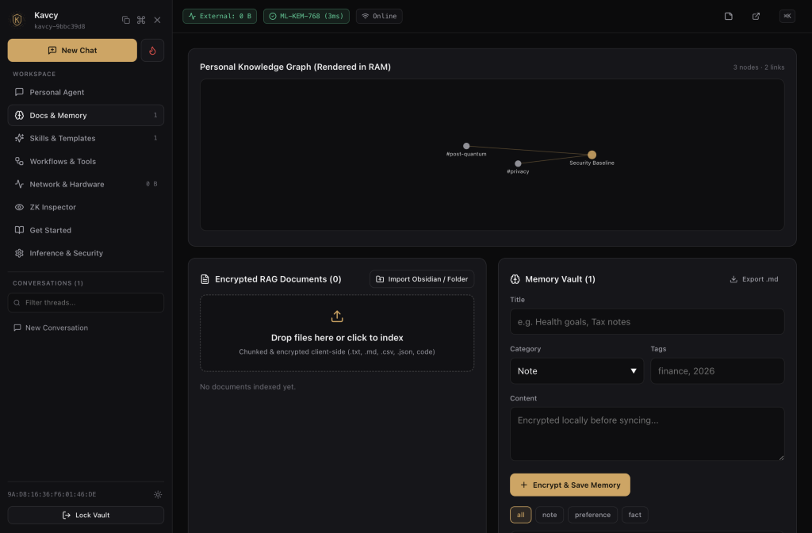
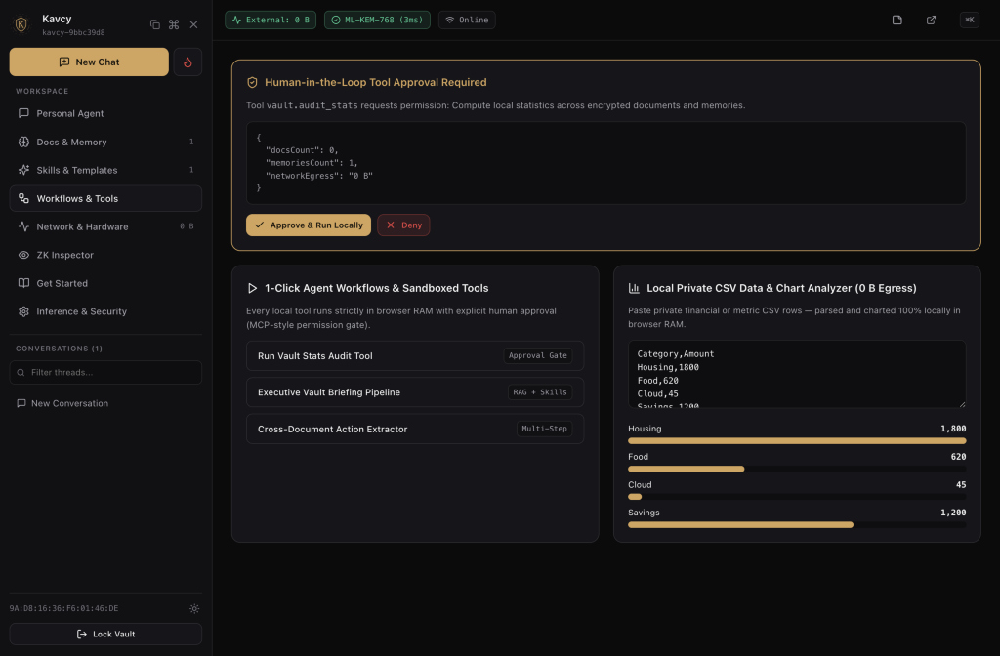
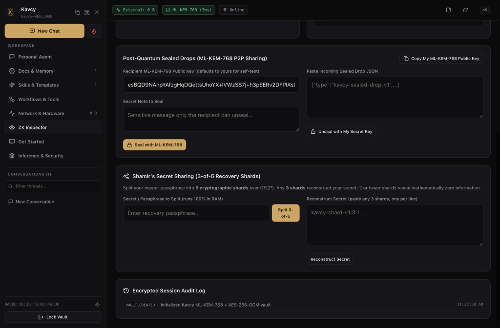

<div align="center">


# Kavcy

**Post-Quantum Zero-Knowledge Personal AI Vault**

[](https://github.com/kavichezliyanr/kavcy/releases/latest)
[](https://github.com/kavichezliyanr/kavcy/actions/workflows/deploy-pages.yml)
[](https://github.com/kavichezliyanr/kavcy/actions/workflows/release-desktop.yml)
[](./LICENSE)
[](./docs/ARCHITECTURE.md)

[Live Landing Page](https://kavichezliyanr.github.io/kavcy/) · [Launch Web App](https://kavichezliyanr.github.io/kavcy/app.html) · [Download Desktop (.dmg / .exe)](https://github.com/kavichezliyanr/kavcy/releases/latest) · [Architecture](./docs/ARCHITECTURE.md) · [Privacy FAQ](./docs/PRIVACY_AND_FAQ.md)

</div>

---

## Downloads

| Platform | Package | Direct Download |
| :--- | :--- | :--- |
| **Web / iPad / Mobile (PWA)** | Zero-install browser workspace | [Launch Kavcy Web App →](https://kavichezliyanr.github.io/kavcy/app.html) |
| **macOS (Apple Silicon)** | Native `.dmg` installer | [Download `Kavcy-1.0.0-arm64.dmg`](https://github.com/kavichezliyanr/kavcy/releases/download/v1.0.0/Kavcy-1.0.0-arm64.dmg) |
| **Windows (Installer)** | NSIS `Setup.exe` | [Download `Kavcy.Setup.1.0.0.exe`](https://github.com/kavichezliyanr/kavcy/releases/download/v1.0.0/Kavcy.Setup.1.0.0.exe) |
| **Windows (Portable)** | Standalone `.exe` | [Download `Kavcy.1.0.0.exe`](https://github.com/kavichezliyanr/kavcy/releases/download/v1.0.0/Kavcy.1.0.0.exe) |

> Always find the latest semantic version on the [GitHub Releases](https://github.com/kavichezliyanr/kavcy/releases/latest) page.

---

## Why Choose Kavcy?

Most cloud chatbots log your prompts and train on your private files. Most local AI tools require Docker, terminal commands, or freeze 8 GB laptops with oversized models. **Kavcy** delivers verifiable post-quantum cryptography with consumer-grade simplicity:

| Capability | Cloud AI Chatbots | Local-Only Tinker Apps | **Kavcy** |
| :--- | :--- | :--- | :--- |
| **Post-Quantum E2EE Vault (`ML-KEM-768`)** | No | Rarely | **Yes (Client-Side Default)** |
| **Realtime Zero-Egress Network Meter** | No | No | **Yes + Air-Gap Kill Switch** |
| **Hardware RAM Guard (Blocks Crashes)** | N/A | Manual | **Automatic Validator** |
| **1-Click Model Unload (Free 100% CPU/RAM)** | N/A | CLI Only | **1-Click Kill Switch** |
| **Client-Side Drag & Drop RAG** | Uploaded plaintext | Often Docker | **100% In-Browser RAM** |
| **Desktop + iPad + Mobile PWA** | Yes | Desktop only | **Responsive Everywhere** |

---

## Visual Walkthrough

<table>
  <tr>
    <td width="50%">
      <strong>1. Post-Quantum Vault Gate</strong><br/>
      
    </td>
    <td width="50%">
      <strong>2. Personal Agent, Skills &amp; Drag-Drop RAG</strong><br/>
      
    </td>
  </tr>
  <tr>
    <td width="50%">
      <strong>3. Realtime 0 B Network Meter &amp; RAM Guard</strong><br/>
      
    </td>
    <td width="50%">
      <strong>4. Built-In Get Started Docs &amp; Checklist</strong><br/>
      
    </td>
  </tr>
  <tr>
    <td width="50%">
      <strong>5. Personal Knowledge Graph &amp; Obsidian Import</strong><br/>
      
    </td>
    <td width="50%">
      <strong>6. Human-Approved Tools &amp; Local CSV Charts</strong><br/>
      
    </td>
  </tr>
  <tr>
    <td colspan="2">
      <strong>7. Post-Quantum ML-KEM-768 Sealed Drops &amp; Shamir 3-of-5 Recovery Shards</strong><br/>
      
    </td>
  </tr>
</table>

---

## Key Features
- **Post-Quantum Cryptography & Shamir Recovery:** NIST FIPS 203 `ML-KEM-768` + `AES-256-GCM` + `PBKDF2-SHA512` (310,000 rounds), **3-of-5 Shamir's Secret Sharing recovery shards** over GF(2⁸), live 1-bit tamper simulator, and 1-click key rotation.
- **Encrypted IndexedDB Vault Engine:** Gigabyte-scale client-side encrypted storage (automatically migrates legacy `localStorage` caches).
- **Ephemeral Burn-After-Close Threads:** Volatile RAM-only conversations that are never written to IndexedDB or sync storage.
- **Native Local Ollama Bridge & Live RAM Telemetry:** Auto-detects local Ollama models, reports real-time `tokens/sec`, streams a live host RAM utilization sparkline, and unloads models in 1 click to free **100% of CPU & RAM**.
- **Split-Pane Live Artifact Canvas:** Edit, refine, copy, and export drafted documents, code, or memos side-by-side next to the chat.
- **Realtime Zero-Egress Proof:** Live `fetch()` byte meter (`External: 0 B`) + **Strict Air-Gap Kill Switch**.
- **Drag-and-Drop Client-Side RAG:** Chunking, TF-IDF citations, Top-K & relevance sliders, and per-document active/paused toggles.
- **Official Developer SDKs:** Embed Kavcy's post-quantum vault, Shamir recovery, and client-side RAG into your own apps with [`@kavcy/sdk` (Node.js/TypeScript)](./sdk/node/README.md) and [`kavcy-sdk` (Python)](./sdk/python/README.md).

---

## Official SDKs (Integrate Kavcy in Your Apps)

### Node.js / TypeScript (`@kavcy/sdk`)
```bash
npm install @kavcy/sdk
```
```js
import { KavcyVault, splitSecret, combineShares, chunkDocument, searchRag } from '@kavcy/sdk';

const vault = await KavcyVault.create('my-vault', 'strong-passphrase');
const envelope = await vault.encrypt({ note: 'Private user memory' });
const shards = splitSecret('strong-passphrase', 5, 3); // 3-of-5 recovery shards
```

### Python (`kavcy-sdk`)
```bash
pip install kavcy-sdk
```
```python
from kavcy import KavcyVault, split_secret, combine_shares, chunk_document, search_rag

vault = KavcyVault("my-py-vault", "strong-passphrase")
envelope = vault.encrypt({"notes": ["Private financial summary"]})
shards = split_secret("strong-passphrase", total_shares=5, threshold=3)
```

---

## Local Development

```bash
git clone https://github.com/kavichezliyanr/kavcy.git
cd kavcy
npm install
npm run dev
```
- Web App: `http://localhost:5173/`
- Landing Page: `http://localhost:5173/landing.html`

### Run Verification Tests & Production Build
```bash
npm run test:crypto
npm run build
```

---

## Documentation
- [Technical Architecture & Cryptographic Spec](./docs/ARCHITECTURE.md)
- [Privacy & Frequently Asked Questions](./docs/PRIVACY_AND_FAQ.md)
- [Security & Threat Model](./SECURITY.md)
- [Contributing Guide](./CONTRIBUTING.md)
- [Changelog](./CHANGELOG.md)
- [Code of Conduct](./CODE_OF_CONDUCT.md)
- [MIT License](./LICENSE)
