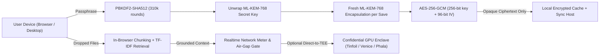

# Kavcy Technical Architecture

Kavcy is designed around a single invariant: **plaintext user data never leaves the client's RAM unless the user explicitly enables an inference endpoint.**

## High-Level Data Flow



## 1. Encrypted Vault Envelope (`src/crypto/pqVault.ts`)
Every vault save generates a **fresh ML-KEM-768 encapsulation** and a **fresh 96-bit AES-GCM IV**:

```json
{
  "version": 2,
  "vaultId": "kavcy-xxxxxxxx",
  "algorithm": "ML-KEM-768+AES-256-GCM",
  "kdf": "PBKDF2-SHA512",
  "iterations": 310000,
  "salt": "<base64 16 bytes>",
  "kemPublicKey": "<base64 1184 bytes>",
  "wrappedKemSecretKey": { "iv": "<base64>", "ciphertext": "<base64>" },
  "kemCiphertext": "<base64 1088 bytes>",
  "encryptedData": { "iv": "<base64>", "ciphertext": "<base64>" }
}
```

- **Quantum Resistance:** Even if an adversary captures ciphertext today ("Harvest Now, Decrypt Later"), breaking the encapsulated key requires solving Module-LWE (NIST FIPS 203 ML-KEM-768).
- **Tamper Resistance:** Modifying even 1 bit of `encryptedData.ciphertext` causes AES-256-GCM authentication to fail immediately. Users can verify this live in **ZK Inspector → Simulate 1-Bit Tamper**.

## 2. Client-Side Drag-and-Drop RAG (`src/utils/ragEngine.ts`)
- Documents dropped into the chat or Knowledge Vault are split into overlapping 550-character chunks (90-character overlap) locally in browser RAM.
- Queries are scored using IDF-weighted token overlap + title/phrase boosts, respecting user-configured `Top-K` and `Min Score` thresholds.
- No plaintext embeddings or inverted search indexes are stored on any server.

## 3. Realtime Zero-Egress Network Meter (`src/utils/networkMeter.ts`)
- Installed before React mounts (`src/main.tsx`), intercepting `window.fetch`.
- Classifies every request as `LOCAL`, `EXTERNAL`, or `BLOCKED` and counts outbound bytes in real time.
- When **Strict Air-Gap Mode** is enabled, any non-localhost request throws before leaving the browser.

## 4. Hardware Compatibility Guard & Model Kill Switch (`src/utils/hardwareCheck.ts`)
- Inspects real host RAM, CPU cores, GPU renderer, and storage via `/api/system-specs` (or browser APIs on static hosts).
- Automatically flags models that exceed available RAM as `INCOMPATIBLE` and blocks download triggers.
- Clicking **Disable & Unload Model** suspends inference and calls `/api/model/unload` (`keep_alive: 0` on Ollama) to immediately reclaim 100% of model CPU and RAM.
